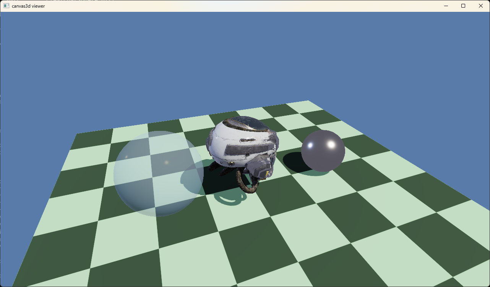

# canvas3d

A small 3D renderer in Go, built on SDL3's GPU API.

**Work in progress.** The goal is a robust, easy-to-use `Canvas` object that handles the window and the rendering with high performance, so it can be a solid base for games and graphics engines.



You make a `Canvas`, and it owns the window and the renderer. You draw things on it every frame.

## What it can do

- One `Canvas` object for the window, the GPU and the renderer
- Meshes: cube, plane and sphere helpers, or your own vertices
- PBR materials: base color, metallic / roughness, normal, occlusion, emissive
- Textures with mipmaps
- Load `.glb` / `.gltf` models
- Up to 4 directional lights, with a shadow map for the first one
- A procedural sky for ambient light and reflections, plus tone mapping
- Alpha (opaque / mask / blend) and double-sided materials
- An orbit camera helper

## Try it

You need Go 1.21 or newer. SDL3 comes bundled through [go-sdl3](https://github.com/Zyko0/go-sdl3), so there is nothing else to install.

```
git clone https://github.com/mendelsh/canvas3d.git
cd canvas3d
go run ./examples/viewer
```

The viewer draws a checkerboard floor with a chrome sphere and a glass sphere. It also loads a model if it finds `assets/DamagedHelmet.glb`, and just skips it if not.

For the full test, download `DamagedHelmet.glb` from its [Khronos glTF Sample Assets page](https://github.com/KhronosGroup/glTF-Sample-Assets/blob/main/Models/DamagedHelmet/README.md), put it in an `assets` folder in the repo, and run the viewer again. You can also pass any other model as an argument:

```
go run ./examples/viewer path\to\model.glb
```

For more models to try, the [Khronos glTF Sample Assets](https://github.com/KhronosGroup/glTF-Sample-Assets) are a good place to look.

Controls:

| Input | What it does |
|---|---|
| Left mouse drag | Orbit |
| Right mouse drag | Pan |
| Mouse wheel | Zoom |
| Space | Pause / resume the spin |
| F | Print FPS |
| Esc | Quit |

## Small example

```go
package main

import (
	"fmt"

	"github.com/mendelsh/canvas3d"
)

func main() {
	canvas, err := canvas3d.CreateCanvas("hello", 800, 600, false)
	if err != nil {
		fmt.Println(err)
		return
	}
	defer canvas.Destroy()

	cube, err := canvas.CreateMesh(canvas3d.CubeDesc(1))
	if err != nil {
		fmt.Println(err)
		return
	}
	defer canvas.DestroyMesh(cube)

	red := canvas.CreateMaterial(&canvas3d.MaterialDesc{
		BaseColor: [4]float32{0.9, 0.2, 0.2, 1},
	})
	defer canvas.DestroyMaterial(red)

	angle := float32(0)
	running := true
	for running {
		var event canvas3d.Event
		for canvas3d.PollEvent(&event) {
			if event.Type == canvas3d.EVENT_QUIT {
				running = false
			}
		}

		if !canvas.BeginFrame() {
			continue
		}
		angle += 0.01
		canvas.AddLight(&canvas3d.Light{Direction: [3]float32{-0.4, -1, -0.6}})
		canvas.DrawMesh(cube, red, canvas3d.RotationY(angle))
		if err := canvas.EndFrame(); err != nil {
			fmt.Println(err)
			return
		}
	}
}
```

A few rules:

- Call everything from the goroutine that runs `main`. SDL wants the main thread.
- `DrawMesh`, `AddLight` and `SetCamera` only record things. The actual drawing happens in `EndFrame`.
- Destroy meshes, materials and textures before the canvas. Destroy materials before the textures they use.
- Angles are in radians.

## How it's laid out

```
canvas3d/
    *.go             the canvas3d package (window, renderer, materials, math...)
    model/           glTF / GLB loader, built only on the public API
    shaders/         compiled shaders (embedded into the library)
    shader_src/      HLSL sources
    build_shaders.bat
    examples/viewer/ the demo above
    docs/            screenshots
```

## Shaders

The shaders are written in HLSL (`shader_src/`) and compiled with `dxc` to DXIL (Direct3D 12) and SPIR-V (Vulkan). The compiled files are committed in `shaders/` and embedded in the library, so you only need `dxc` if you change a shader.

To rebuild them, set the `DXC` path at the top of `build_shaders.bat` to the `dxc.exe` from the Vulkan SDK (the one in the Windows SDK has no SPIR-V support), then run the script.

## Status

Work in progress, so the API will probably change. The aim is a canvas you can rely on: simple to use, fast, and solid enough to build games and graphics engines on.

- Only tested on Windows with Direct3D 12 so far. Vulkan and Metal are not tried yet, and the shaders still need converting for them.
- Only the first light casts a shadow, and the shadow area is set by hand with `SetShadowArea`.
- Blended (transparent) objects don't cast shadows, and they are sorted by their origin.
- Not done yet: image-based lighting, automatic shadow area and cascades, anti-aliasing, bloom.

## Thanks

- [go-sdl3](https://github.com/Zyko0/go-sdl3) by Zyko0 for the SDL3 bindings. The event and key definitions in this repo are adapted from it (MIT).
- [qmuntal/gltf](https://github.com/qmuntal/gltf) for reading glTF files.
- The helmet used in the test is the Battle Damaged Sci-fi Helmet by theblueturtle_ (CC BY-NC 4.0), rebuilt as glTF by ctxwing (CC BY 4.0), from the [Khronos glTF Sample Assets](https://github.com/KhronosGroup/glTF-Sample-Assets). It is not included in this repo.

## License

MIT, see `LICENSE`.
